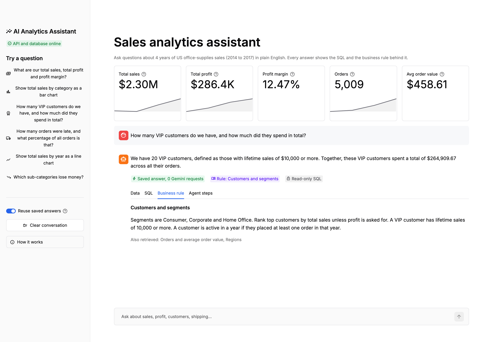
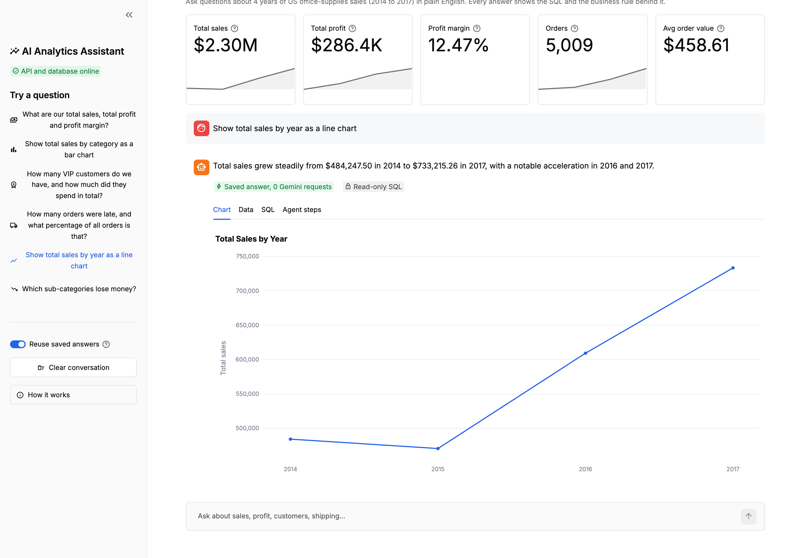
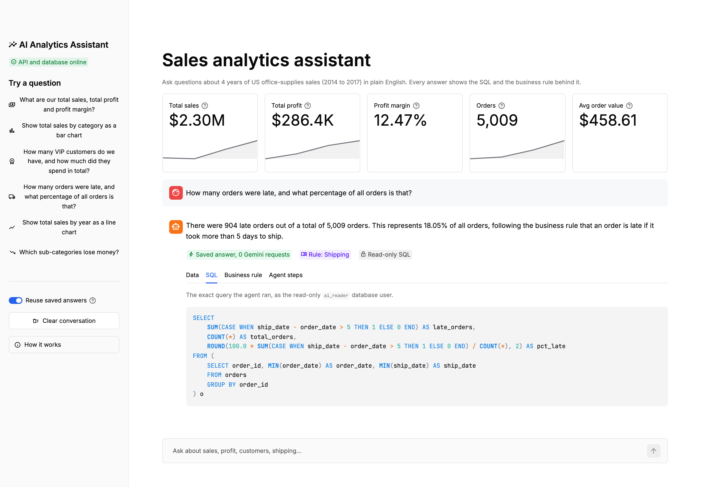
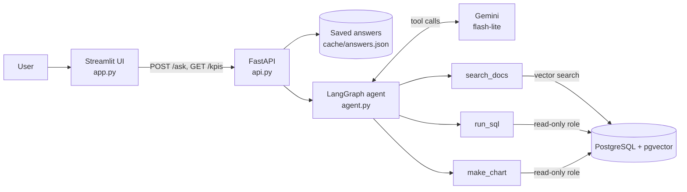

# AI Analytics Assistant

Ask business questions about sales data in plain English and get a trustworthy answer: the numbers, the exact SQL that produced them, the company rule that was applied, and an interactive chart.



Built on four years of US office-supplies retail data (Superstore, 9,994 order lines, 2014 to 2017).

## What it does

- **Answers in plain English** with the key numbers, for example *"We have 20 VIP customers, who spent $264,909.67 in total."*
- **Shows its work.** Every answer comes with the SQL it ran, the result table and each step the agent took.
- **Knows the company's definitions.** Terms like *VIP*, *late order*, *heavy discount* and *AOV* are looked up in the business notes (RAG with pgvector) before any SQL is written.
- **Draws charts** on request, rendered as interactive Plotly charts.
- **KPI header** with total sales, profit, margin, orders and average order value.

| Chart answer | SQL transparency |
|---|---|
|  |  |

## Architecture



1. The **Streamlit UI** sends the question to the **FastAPI** backend.
2. The **LangGraph agent** gives Gemini three tools and lets it loop:
   - `search_docs` embeds the question (all-MiniLM-L6-v2) and finds the closest business-note sections in pgvector.
   - `run_sql` runs a SELECT on PostgreSQL and returns the rows.
   - `make_chart` runs a 2-column query and returns chart data.
3. The API turns the agent's conversation into a structured answer: text, SQL, result table, business rule, chart data and agent steps.

| File | Role |
|---|---|
| `app.py` | Streamlit UI |
| `api.py` | FastAPI backend (`/ask`, `/kpis`, `/health`) |
| `agent.py` | LangGraph agent and system prompt |
| `agent_tools.py` | The three tools and the SQL guardrail |
| `search_docs.py`, `ingest_docs.py` | RAG: embed and search `docs/business_notes.md` |
| `text_to_sql.py`, `rag_answer.py` | Earlier phases: one-shot text-to-SQL and RAG |
| `eval.py` | Checks answers against the answer key |
| `sql/` | Schema, cleaning, practice queries, read-only role, answer keys |

## Safety guardrails

The model never gets write access, and every layer assumes the one before it could fail.

| Layer | Guardrail |
|---|---|
| Database role | The agent connects as `ai_reader`: `SELECT` on 4 tables only, `default_transaction_read_only = on`, 5 second `statement_timeout`. |
| Query check | `check_select()` refuses anything that is not one `SELECT`/`WITH` statement, and blocks keywords such as `DROP`, `DELETE`, `UPDATE` and `pg_sleep` before the query reaches Postgres. |
| Row limit | Results are capped (20 rows to the model, 100 to the UI). |
| Agent loop cap | At most 12 steps (6 Gemini requests) per question; the UI says so if the cap is hit. |
| Grounded numbers | The prompt requires every number to come from `run_sql`, and the UI shows the SQL and the raw rows so anyone can check. |
| Secrets | API keys and passwords live in `.env`, which is git-ignored. |
| Cost | Gemini free tier only. Saved answers cost 0 requests, and the API falls back to a second free model if the first one's daily quota runs out. |

## Results

`python eval.py` compares the agent's result tables against queries written by hand (`sql/03_practice_queries.sql`, `sql/06_rag_answer_key.sql`):

| Question | Expected (answer key) | Result |
|---|---|---|
| Total sales, profit and margin | $2,297,200.86, $286,397.02, 12.47% | Pass |
| Sales by category (bar chart) | Technology $836,154.03, Furniture $741,999.80, Office Supplies $719,047.03 | Pass |
| VIP customers (rule: lifetime sales >= $10,000) | 20 | Pass |
| Late orders (rule: more than 5 days to ship) | 904 (18.0%) | Pass |
| Sales by year (line chart) | $484,247.50 to $733,215.26 | Pass |
| Sub-categories that lose money | Tables, Bookcases, Supplies | Pass |

**6/6 pass.** The earlier RAG phase scored 4/4 on rule-based questions.

## Run it

You need Docker Desktop, Python 3.12+ and a free Gemini API key.

```bash
cp .env.example .env        # then fill in GEMINI_API_KEY and the passwords
```

### Option A: locally (recommended for development)

```bash
docker start sales-db                                   # Postgres + pgvector
source .venv/bin/activate
uvicorn api:app --port 8000                             # terminal 1
streamlit run app.py                                    # terminal 2
```

Open http://localhost:8501.

### Option B: Docker Compose (database, API and UI)

```bash
docker stop sales-db          # Compose runs its own copy on the same data volume
docker compose up --build
```

Open http://localhost:8501. The API docs are at http://localhost:8000/docs.

### API

```bash
curl -X POST localhost:8000/ask -H 'content-type: application/json' \
     -d '{"question": "How many VIP customers do we have?"}'
```

Send `"fresh": true` to skip the saved answer and ask Gemini again.

## Getting the data

The raw data is not stored in this repo (it's in `.gitignore`). To rebuild the database:

1. Download "Superstore Dataset (Final)" by vivek468 from Kaggle: https://www.kaggle.com/datasets/vivek468/superstore-dataset-final and save the zip as `data/raw/superstore.zip`.
2. Unzip it and rename the CSV:
   ```
   unzip data/raw/superstore.zip -d data/raw
   mv "data/raw/Sample - Superstore.csv" data/raw/superstore.csv
   ```
3. Convert it from Windows-1252 to UTF-8:
   ```
   iconv -f WINDOWS-1252 -t UTF-8 data/raw/superstore.csv > data/raw/superstore_utf8.csv
   ```
4. Build the tables (Postgres must be running in the `sales-db` container):
   ```
   docker exec -i sales-db psql -U analyst -d sales < sql/01_staging.sql
   docker exec -i sales-db psql -U analyst -d sales -c "\copy stg_superstore FROM pstdin WITH (FORMAT csv, HEADER true)" < data/raw/superstore_utf8.csv
   docker exec -i sales-db psql -U analyst -d sales < sql/02_clean_tables.sql
   ```
5. Create the read-only role and load the business notes:
   ```
   docker exec -i sales-db psql -U analyst -d sales -v ai_password="$AI_DB_PASSWORD" < sql/04_readonly_role.sql
   docker exec -i sales-db psql -U analyst -d sales < sql/05_doc_chunks.sql
   python ingest_docs.py
   ```

## Tech stack

Python, PostgreSQL 17 + pgvector, LangChain / LangGraph, Google Gemini (free tier), sentence-transformers, FastAPI, Streamlit, Plotly, Docker.
